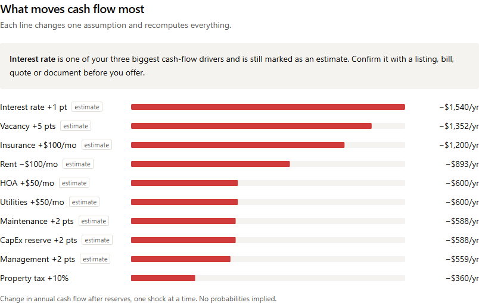
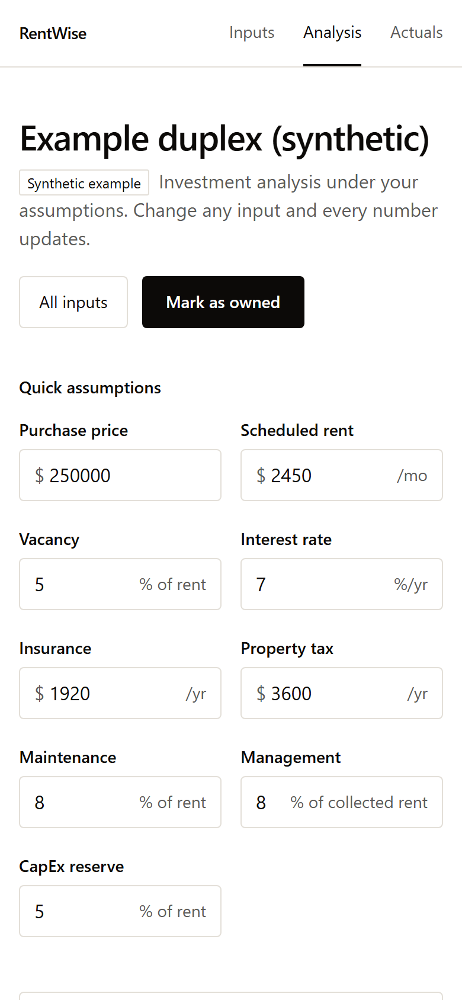
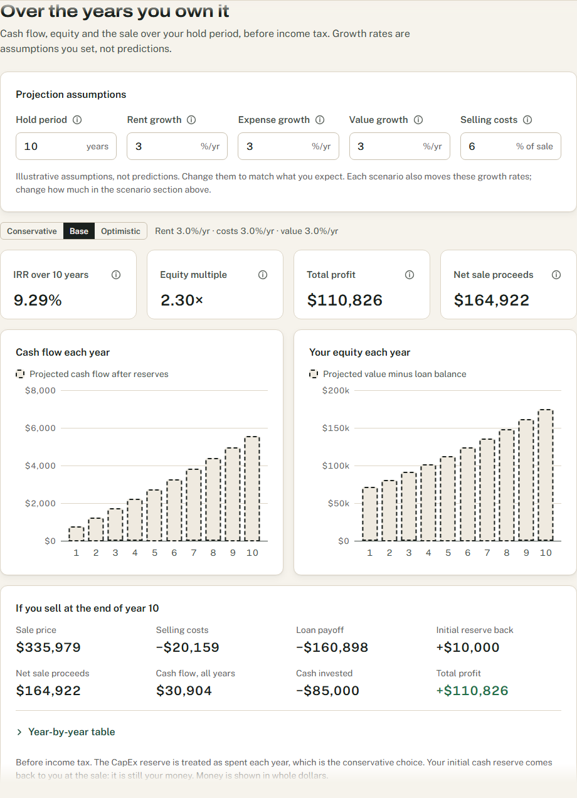
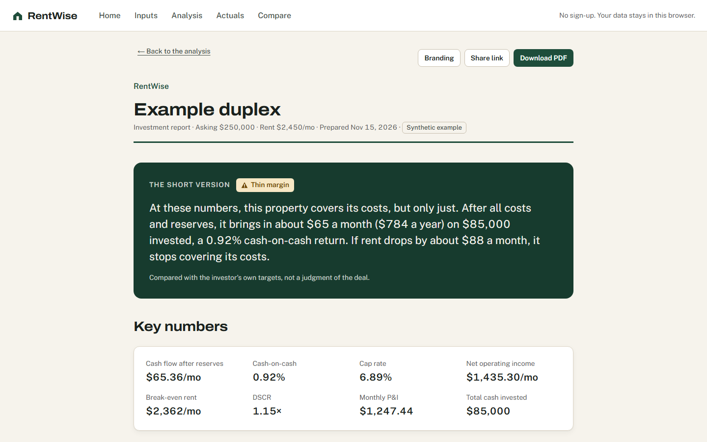
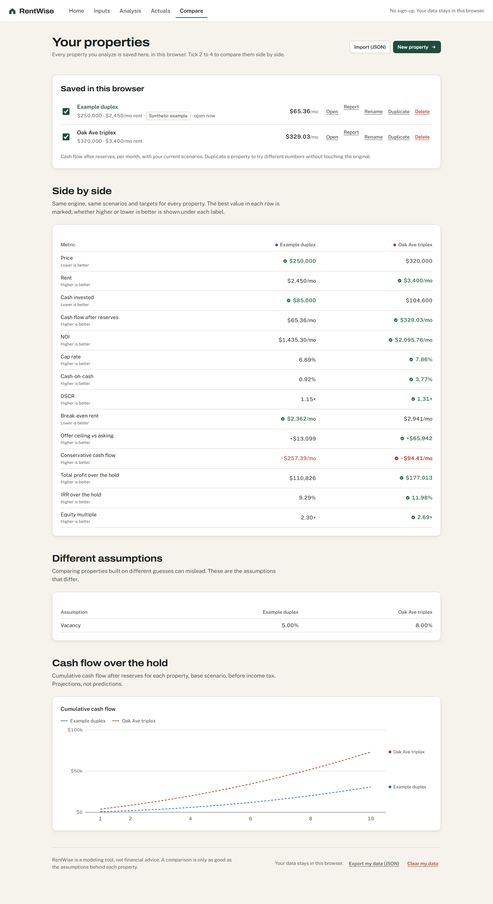

# RentWise

**Know the numbers before you buy. Know the truth after you buy.**

RentWise is a browser-only financial modeling tool for small U.S. long-term rental investors. It connects the
assumptions you underwrite before buying with the actual results you record after buying, and explains the
difference to the cent.

**Live demo:** https://rentwise-gamma-three.vercel.app · No sign-up. Click "Try the example property" for a synthetic walkthrough.
**User guide:** [GUIDE.md](GUIDE.md) explains every input and result.

> Financial modeling and education only. Not investment, legal, mortgage or tax advice. Results depend entirely on
> your assumptions; nothing here is a guaranteed return.


## Problem

First-time landlords underestimate ownership costs (vacancy, repairs, CapEx, management) and almost never go back
to compare the plan they bought on with what actually happened. Underwriting calculators stop at purchase, and
bookkeeping tools start after it. Nothing connects the two, so investors repeat the same estimating mistakes on the
next deal.

## Audience

U.S. adults aged 25–45 who are buying their first long-term rental or own 1–5 properties. They are comfortable
with a spreadsheet but don't want to build and audit one for every deal.

## Features

The workflow is **Analyze → Stress test → Offer ceiling → Track actuals → Explain variance**.

| Step | What you get |
|---|---|
| Analyze | Gross and effective rent, operating expenses, NOI, monthly P&I, cash flow before CapEx, cash flow after reserves, cap rate, cash-on-cash, break-even rent and total cash invested. Every number updates (and animates) as you edit. |
| Stress test | Conservative, base and optimistic scenarios with visible, editable adjustments. |
| Offer ceiling | The highest price that still meets your targets: minimum cash flow, cash-on-cash, cap rate, DSCR and IRR over the hold, maximum upfront cash, and optionally "must also pass the conservative scenario". Shows the price each target allows on its own and names the binding one ("Cash-on-cash ≥ 8% is the binding limit; cash flow would allow $263,099"). |
| Sensitivity | Which assumption moves cash flow most, in real dollars ("Insurance +$100/mo = −$1,200/yr"). High-impact assumptions still marked as estimates are flagged. No probabilities. |
| Project the hold | Year-by-year cash flow, NOI, loan balance, value and equity over a 1–30 year hold, the sale, IRR, equity multiple and total profit, before income tax. Runs for all three scenarios, whose growth rates move too. |
| Compare | Every property you analyze is saved in this browser. Compare 2–4 side by side: 14 metrics with the best value marked per row, a "Different assumptions" block, and cumulative cash flow on one chart. Phones get a pick-two, metric-first layout. |
| Report and share link | A read-only investment report (all assumptions with their source labels, scenarios, sensitivity, offer ceiling, projection, disclaimer) with your own name, color and logo. Download it as a PDF through the browser's print, or share a link that carries the inputs only and is recalculated in the recipient's browser. |
| Track actuals | "Mark as owned" locks the plan. Monthly entries are prefilled from the forecast, editable, and persist in your browser. |
| Explain variance | Forecast vs. actual rent, operating costs and cash flow before CapEx, plus a monthly plan-vs-actual chart and a contributor table that sums **exactly** to the total variance. Includes a plain-English explanation. CapEx is compared to the reserve separately. |

Each key assumption can be tagged with where it came from: estimate, listing, bill, quote or document.
"Export my data" downloads JSON, and "Clear my data" wipes everything.

| Analysis | Offer ceiling |
|---|---|
|  |  |

| Sensitivity | Mobile (390px) |
|---|---|
|  |  |

| Projection | Report |
|---|---|
|  |  |



**Actuals vs. plan.** A surprise $1,800 repair explains the full −$1,800.00 variance:


## Financial assumptions

All money in the engine is **integer cents**; rates are fractions. Each line item is rounded to the cent once
(half away from zero), and every total is an integer sum of its lines, so totals always reconcile.
NaN and Infinity are rejected.

| Metric | Definition |
|---|---|
| Loan | price × (1 − down payment %). All-cash → 0. |
| Monthly P&I | L·r / (1 − (1 + r)^−n), with r = annual rate / 12 and n = years × 12. If r = 0 → L / n. |
| Effective rent | rent × (1 − vacancy %) |
| Operating expenses | tax/12 + insurance/12 + HOA + utilities + other fixed + maintenance (rent × %) + management (effective rent × %) |
| NOI | effective rent + other income − operating expenses. Excludes debt service, CapEx reserve, income tax and depreciation. |
| Cash flow before CapEx | NOI − P&I |
| Cash flow after reserves | cash flow before CapEx − CapEx reserve (rent × %) |
| Cash invested | down payment + closing costs + initial repairs + initial reserve |
| Cap rate | 12 × NOI / price |
| Cash-on-cash | 12 × cash flow after reserves / cash invested (n/a when cash invested ≤ 0) |
| Break-even rent | The rent at which cash flow after reserves is $0 (solved in closed form, shown in whole dollars) |
| Offer ceiling | A binary search to $1 between $1 and max(4 × asking, $2M). Every candidate recomputes the loan, down payment and percentage closing costs. Rent, tax and insurance are held at your inputs (disclosed in the UI). Cash flow, cash-on-cash, cap rate, DSCR (NOI ÷ P&I; no mortgage passes) and upfront cash only get worse as the price rises. IRR may not, because value growth scales with the price, so an IRR target is checked at that ceiling and, if it fails, by a 120-step scan downward and a bisection on the highest passing bracket. Every result is re-validated; an infeasible target returns an explicit state naming it, never 0. |
| Variance | Actual − forecast over exactly the months entered, using the same cash-flow definition. Income impact = actual − forecast; expense impact = forecast − actual (positive = better). Contributor impacts are integer cents and sum exactly to the total. A planned reserve is never treated as an expense. |

**Reference test** (from the spec, asserted in `tests/finance`): a $250,000 price, $2,450 rent, 25% down, 7% over
30 years and 3% closing costs give P&I $1,247.44, effective rent $2,327.50, operating expenses $892.20,
NOI $1,435.30, cash flow before CapEx $187.86, cash flow after reserves $65.36, cash invested $85,000,
a 6.8894% cap rate and 0.9227% cash-on-cash.

### Multi-year projection (before income tax)

| Item | Definition |
|---|---|
| Year 1 | 12 × the monthly figures above, using the **unrounded** P&I. Growth starts in year 2. |
| Year y income | rent and other income × (1 + rent growth)^(y−1); vacancy applies to rent only |
| Year y costs | tax, insurance, HOA, utilities and other fixed costs × (1 + expense growth)^(y−1); maintenance, management and the CapEx reserve stay a % of rent, so they grow with rent |
| Cash flow | NOI − debt service − CapEx reserve, the same definition as cash flow after reserves. Debt service stops once the loan is paid off. |
| Loan balance | the balance after 12y payments (standard amortization); 0 for all-cash or once paid off |
| Value | price × (1 + value growth)^y |
| Sale (end of year N) | sale price = value N; net sale proceeds = sale − selling costs − loan payoff + initial cash reserve |
| IRR | of [−cash invested, cf₁, …, cf_N + net sale proceeds]: Newton–Raphson with a bisection fallback. No sign change, no investment or no convergence returns "n/a", never NaN. |
| Equity multiple, total profit | (Σ cash flow + net sale proceeds) ÷ cash invested; Σ cash flow + net sale proceeds − cash invested |

Two choices are disclosed on screen: **the CapEx reserve is treated as spent** each year (the conservative choice),
and **the initial cash reserve is returned at the sale** (it is still the owner's money). Defaults: 10-year hold,
3% rent, expense and value growth, 6% selling costs. These are illustrative assumptions, not predictions. The
conservative and optimistic scenarios also move growth: −/+2 points of rent and value growth, and +1 point of
expense growth in the conservative case. All of it is editable.

**Projection reference test** (the example, 10-year hold, defaults; computed independently from these definitions
and asserted in `tests/finance/projection.test.ts` to ±$0.05 and ±0.01 points):

| Check | Expected |
|---|---|
| Year 1 NOI / cash flow | $17,223.60 / $784.29 (= $65.36 × 12 within rounding, from the unrounded P&I) |
| Year 2 NOI / cash flow | $17,740.31 / $1,256.90 |
| Year 5 NOI / cash flow | $19,385.31 / $2,761.51 |
| Year 10 NOI / cash flow | $22,472.89 / $5,585.57 |
| Loan balance, end of year 1 / year 10 | $185,595.36 / $160,898.22 |
| Value, year 10 | $335,979.09 |
| Cumulative cash flow, 10 years | $30,904.31 |
| Net sale proceeds (including the $10,000 reserve back) | $164,922.13 |
| Total profit | $110,826.44 |
| Equity multiple | 2.3038× |
| IRR | 9.2883% |

Also tested: all-cash, 0% interest, 1- and 30-year holds, holding past the loan's payoff, losses every year,
0% growth (year N = year 1), other income growth, $0 invested, and IRR with no solution. The Phase 1 offer-ceiling
outputs were captured before any change and are locked by `tests/finance/offer-ceiling.test.ts`.

Default percentages (vacancy 5%, maintenance 8%, management 8%, CapEx 5%) and the scenario adjustments are
**illustrative assumptions, not local market data**, and are labeled that way in the app.

## Architecture

Next.js App Router · TypeScript · Tailwind CSS v4 · Zod · Vitest · Playwright.
There is no backend, database or account system. The finance engine is pure TypeScript with no React and no network.

```
src/
  app/                 page (landing), analyze, results, performance, compare, report/[id], r (shared link)
  components/
    forms/             PropertyForm, NumberField, field definitions
    results/           metrics, scenarios, offer ceiling, projection, sensitivity, animated numbers
    charts/            PlanVsActual, YearChart, CompareChart (plain HTML/CSS and SVG)
    report/            Report (read-only), SharePanel
  lib/
    finance/           types, money, mortgage, underwriting, scenarios, offer-ceiling, sensitivity, variance, projection, irr
    validation.ts      Zod schemas (guards everything read from storage)
    storage.ts         versioned localStorage store ("rentwise:v2", many properties) via useSyncExternalStore
    compare.ts         per-deal metrics, best value per row, differing assumptions
    share.ts           share-link encoding: inputs only, Zod-validated, deflate-compressed into the URL fragment
    branding.ts        accent contrast check (WCAG AA) and logo reading (PNG/JPG, ≤ 200 KB)
    explain.ts         deterministic variance explanation
    format.ts          currency/percent formatting (true minus signs, tabular numbers)
  data/demo-property.ts  synthetic example (doubles as the reference test fixture)
tests/
  finance/             Vitest: engine, projection, IRR, offer ceiling, compare, storage and migration, share link, branding
  e2e/                 Playwright: the full journey on 5 browser setups
```

Layers stay separate: finance logic → validation → state → UI. Storage writes are validated before they are saved,
so an invalid edit can never corrupt saved data. Corrupt or old saved data falls back to an empty state instead of
crashing. Storage failures show a notice on every page with retry controls. Unsaved changes remain available for
JSON export, and closing or reloading the tab prompts before discarding them. Failed deletion preserves the current
data until the browser confirms it was removed.

**Storage migration (v1 → v2).** Phase 1 saved one property under `rentwise:v1`. On the first visit after the
upgrade, it becomes the first saved property under `rentwise:v2`, with its locked plan, recorded months, scenarios
and targets; a test runs this on a state captured from production. `rentwise:v1` is never written, so rolling back
still finds the old data; "Clear my data" removes both. Exports are now v2 files, and import accepts v1 or v2 files,
validated before anything is added. Scenarios and targets apply to every property.

**Share links.** A link carries the inputs, scenarios, targets and branding, never results, in the URL fragment
(`/r#v1.…`), which browsers do not send to a server. It is compressed with the browser's built-in
`CompressionStream` (no extra dependency) and validated with the same Zod schemas as typed input; oversized,
tampered, cut-off or newer links show an error page instead of numbers. Actuals are included only when ticked, and a
logo that would push the link past 8,000 characters is left out, with a note.

## Local setup

Requires Node.js 20 or later (developed on Node 26).

```bash
npm install
npm run dev          # http://localhost:3000
```

### Environment variables

None. The app has no API keys, server secrets or external services.

## Tests

```bash
npm test             # Vitest: engine, projection, offer ceiling, storage, migration, share link (120 tests)
npm run typecheck
npm run lint

npx playwright install chromium webkit firefox   # once
npm run test:e2e     # builds, starts a fresh server, runs every test on 5 browser setups
E2E_BASE_URL=https://your-deployment npm run test:e2e   # same suite against production
```

GitHub Actions runs `.github/workflows/ci.yml` on every push, pull requests targeting `main`, and manual runs
from the Actions tab. It checks lint, TypeScript and unit tests independently, then builds the production app and
runs all five Playwright configurations on Node.js 22. Browser reports and failure traces are available as the
`playwright-results` artifact for 14 days. No repository secrets are required.

The e2e suite runs on Chromium (desktop 1440px and mobile 390px), desktop Safari, iPhone (WebKit) and desktop
Firefox. Every expected number below was computed by hand, not copied from the app. It covers:
- the no-sign-up example and its numbers;
- the numbers changing when an input changes (vacancy 5% → 10%: $65.36 → −$47.34);
- the offer ceiling ($223,017 at ≥ $200/mo) and its infeasible state;
- "must also pass the conservative scenario" lowering the ceiling to $158,334;
- an all-cash purchase: no P&I, "not limited by your targets", then cash-on-cash ceilings of $176,621 (8%) and
  $291,332 (5%);
- "Mark as owned", then a month with a $1,800 repair, with variance reconciling to −$1,800.00;
- data persisting after a reload;
- re-saving a month replacing it instead of double-counting;
- invalid property and actuals entries blocking submission until corrected or reset;
- disabled financing fields allowing all-cash purchases;
- loading the example never silently replacing edited assumptions, targets or recorded months;
- JSON export downloading the saved data;
- storage failures, exporting unsaved actuals, and retrying loads, saves and deletion;
- unread saved data staying protected until a successful load, and invalid Quick assumptions blocking plan locking;
- the empty states and clearing data;
- Phase 1 data migrating on the first visit with nothing lost;
- the projection's IRR (9.29%), the binding offer-ceiling target ("Cash-on-cash ≥ 8% is the binding limit"), an
  IRR target and the infeasible state;
- two saved properties compared with the best value marked per row, on desktop and phone layouts;
- the report, a refused low-contrast accent, and the print view;
- a share link opened read-only in a fresh browser, saved on request, and a cut-off link explaining itself;
- no console errors and no horizontal scroll at 390px.

The Vitest storage tests check invalid edits, corrupt saved data, storage access and quota failures, and retrying
without losing the latest valid changes or overwriting data that could not be loaded.

## Limitations

- Everything is stored only in this browser's localStorage, up to 50 properties. Clearing site data deletes it; use
  Export. The open property is shared across tabs: opening another property in a second tab also switches the first.
- The offer ceiling holds rent, property tax and insurance constant across prices. An IRR target is checked on a
  120-step scan, so a very narrow passing price range could be missed (the result says so). The "IRR didn't fall
  steadily as the price rose" warning has no automated test: no realistic inputs we found trigger it.
- Projections are before income tax, with no depreciation or tax modeling. Growth rates are assumptions you set,
  not predictions, and the app contains no market data.
- Anyone with a share link sees the numbers in it. Links have no expiry and can't be revoked, because nothing is
  stored on a server.
- The report page is rendered on demand, so its first visit after a quiet period can take a few seconds.
- The variance explanation is rule-based. There is no AI explanation yet.

## Roadmap

- A portfolio view across owned properties.
- An optional AI explanation that only reads computed metrics, never changes numbers, and has a deterministic
  fallback.
- Optional cloud sync (a paid tier), which would also allow revocable share links.
- Tax and depreciation modeling, clearly labeled as estimates.

## Sources

- Formulas: standard fixed-rate mortgage amortization and the metric definitions in the table above.
- The example property is **synthetic**. It is not a real listing.
- The app contains no market data. Every default percentage is an illustrative assumption, labeled as such.
