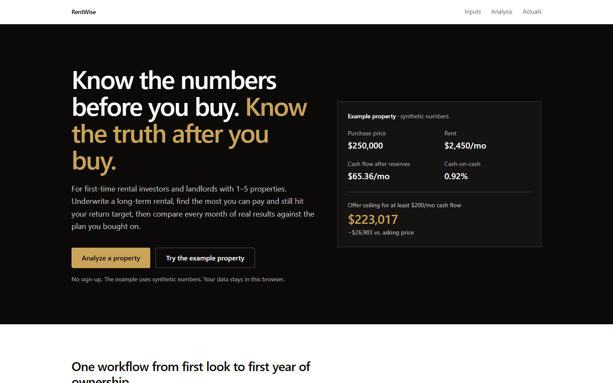
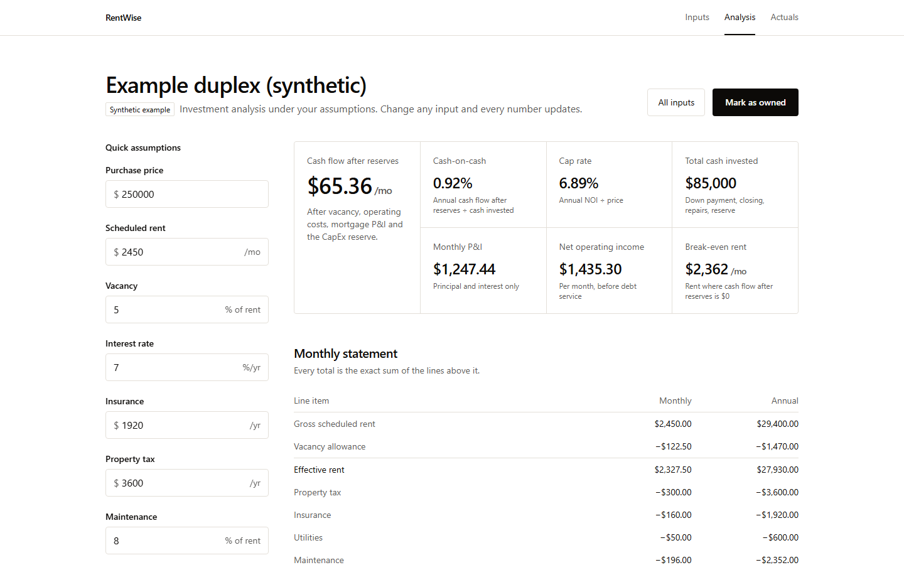
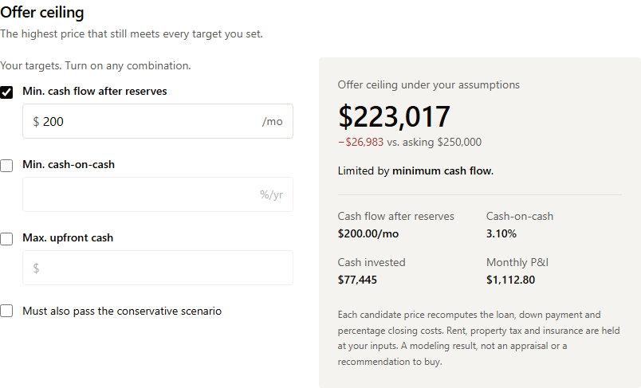
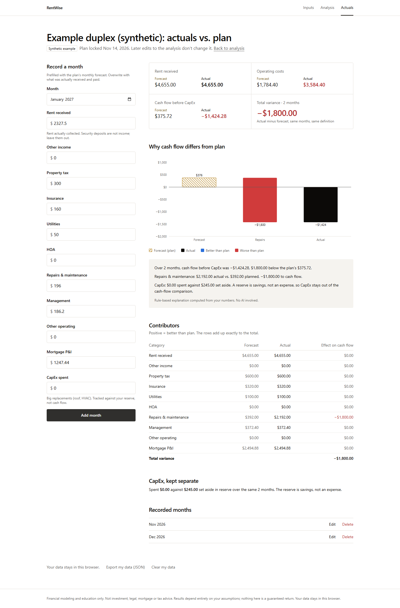

# RentWise

**Know the numbers before you buy. Know the truth after you buy.**

RentWise is a browser-only financial modeling tool for small U.S. long-term rental investors. It connects the
assumptions you underwrite before buying with the actual results you record after buying, and explains the
difference to the cent.

**Live demo:** _not deployed yet_ · No sign-up. Click "Try the example property" for a synthetic walkthrough.
**User guide:** [GUIDE.md](GUIDE.md) explains every input and result.

> Financial modeling and education only. Not investment, legal, mortgage or tax advice. Results depend entirely on
> your assumptions; nothing here is a guaranteed return.



## Problem

First-time landlords underestimate ownership costs (vacancy, repairs, CapEx, management) and almost never go back
to compare the plan they bought on with what actually happened. Underwriting calculators stop at purchase, and
bookkeeping tools start after it. Nothing connects the two, so investors repeat the same estimating mistakes on the
next deal.

## Audience

U.S. adults aged 25–45 who are buying their first long-term rental or own 1–5 properties. They are comfortable
with a spreadsheet but don't want to build and audit one for every deal.

## Features

The workflow is **Analyze → Stress test → Offer ceiling → Track actuals → Explain variance**.

| Step | What you get |
|---|---|
| Analyze | Gross and effective rent, operating expenses, NOI, monthly P&I, cash flow before CapEx, cash flow after reserves, cap rate, cash-on-cash, break-even rent and total cash invested. Every number updates (and animates) as you edit. |
| Stress test | Conservative, base and optimistic scenarios with visible, editable adjustments. |
| Offer ceiling | The highest price that still meets your targets (minimum cash flow, minimum cash-on-cash, maximum upfront cash, optionally "must pass conservative"). Shows the difference from asking, the limiting target, the metrics at that price, and a clear "no price works" state. |
| Sensitivity | Which assumption moves cash flow most, in real dollars ("Insurance +$100/mo = −$1,200/yr"). High-impact assumptions still marked as estimates are flagged. No probabilities. |
| Track actuals | "Mark as owned" locks the plan. Monthly entries are prefilled from the forecast, editable, and persist in your browser. |
| Explain variance | Forecast vs. actual rent, operating costs and cash flow before CapEx, plus a waterfall chart and a contributor table that sums **exactly** to the total variance. Includes a plain-English explanation. CapEx is compared to the reserve separately. |

Each key assumption can be tagged with where it came from: estimate, listing, bill, quote or document.
"Export my data" downloads JSON, and "Clear my data" wipes everything.

| Analysis | Offer ceiling |
|---|---|
|  |  |

| Sensitivity | Mobile (390px) |
|---|---|
|  |  |

**Actuals vs. plan.** A surprise $1,800 repair explains the full −$1,800.00 variance:



## Financial assumptions

All money in the engine is **integer cents**; rates are fractions. Each line item is rounded to the cent once
(half away from zero), and every total is an integer sum of its lines, so totals always reconcile.
NaN and Infinity are rejected.

| Metric | Definition |
|---|---|
| Loan | price × (1 − down payment %). All-cash → 0. |
| Monthly P&I | L·r / (1 − (1 + r)^−n), with r = annual rate / 12 and n = years × 12. If r = 0 → L / n. |
| Effective rent | rent × (1 − vacancy %) |
| Operating expenses | tax/12 + insurance/12 + HOA + utilities + other fixed + maintenance (rent × %) + management (effective rent × %) |
| NOI | effective rent + other income − operating expenses. Excludes debt service, CapEx reserve, income tax and depreciation. |
| Cash flow before CapEx | NOI − P&I |
| Cash flow after reserves | cash flow before CapEx − CapEx reserve (rent × %) |
| Cash invested | down payment + closing costs + initial repairs + initial reserve |
| Cap rate | 12 × NOI / price |
| Cash-on-cash | 12 × cash flow after reserves / cash invested (n/a when cash invested ≤ 0) |
| Break-even rent | The rent at which cash flow after reserves is $0 (solved in closed form, shown in whole dollars) |
| Offer ceiling | A binary search to $1 between $1 and max(4 × asking, $2M). Every candidate recomputes the loan, down payment and percentage closing costs. Rent, tax and insurance are held at your inputs (disclosed in the UI). The result is re-validated, and an infeasible target returns an explicit state, never 0. |
| Variance | Actual − forecast over exactly the months entered, using the same cash-flow definition. Income impact = actual − forecast; expense impact = forecast − actual (positive = better). Contributor impacts are integer cents and sum exactly to the total. A planned reserve is never treated as an expense. |

**Reference test** (from the spec, asserted in `tests/finance`): a $250,000 price, $2,450 rent, 25% down, 7% over
30 years and 3% closing costs give P&I $1,247.44, effective rent $2,327.50, operating expenses $892.20,
NOI $1,435.30, cash flow before CapEx $187.86, cash flow after reserves $65.36, cash invested $85,000,
a 6.8894% cap rate and 0.9227% cash-on-cash.

Default percentages (vacancy 5%, maintenance 8%, management 8%, CapEx 5%) and the scenario adjustments are
**illustrative assumptions, not local market data**, and are labeled that way in the app.

## Architecture

Next.js App Router · TypeScript · Tailwind CSS v4 · Recharts · Zod · Vitest · Playwright.
There is no backend, database or account system. The finance engine is pure TypeScript with no React and no network.

```
src/
  app/                 page (landing), analyze, results, performance
  components/
    forms/             PropertyForm, NumberField, field definitions
    results/           metrics, scenarios, offer ceiling, sensitivity, animated numbers
    charts/            VarianceWaterfall (Recharts)
  lib/
    finance/           types, money, mortgage, underwriting, scenarios, offer-ceiling, sensitivity, variance
    validation.ts      Zod schemas (guards everything read from storage)
    storage.ts         versioned localStorage store ("rentwise:v1") via useSyncExternalStore
    explain.ts         deterministic variance explanation
    format.ts          currency/percent formatting (true minus signs, tabular numbers)
  data/demo-property.ts  synthetic example (doubles as the reference test fixture)
tests/
  finance/             Vitest: engine, edge cases, reconciliation, explanation
  e2e/                 Playwright: the full journey at 1440px and 390px
```

Layers stay separate: finance logic → validation → state → UI. Storage writes are validated before they are saved,
so an invalid edit can never corrupt saved data. Corrupt or old saved data falls back to an empty state instead of
crashing.

## Local setup

Requires Node.js 20 or later (developed on Node 26).

```bash
npm install
npm run dev          # http://localhost:3000
```

### Environment variables

None. The app has no API keys, server secrets or external services.

## Tests

```bash
npm test             # Vitest finance suite (36 tests)
npm run typecheck
npm run lint

npx playwright install chromium   # once
npm run test:e2e     # builds, starts a fresh server, runs the journey on desktop and mobile
E2E_BASE_URL=https://your-deployment npm run test:e2e   # same journey against production
```

The e2e journey covers:
- the no-sign-up example and its numbers;
- the numbers changing when an input changes;
- the offer ceiling and its infeasible state;
- "Mark as owned", then a month with a $1,800 repair, with variance reconciling to −$1,800.00;
- data persisting after a reload;
- re-saving a month replacing it instead of double-counting;
- the empty states and clearing data;
- no console errors and no horizontal scroll at 390px.

## Limitations

- One property at a time, stored only in this browser's localStorage. Clearing site data deletes it; use Export.
- The offer ceiling holds rent, property tax and insurance constant across prices. The search assumes a higher price
  never helps, which holds for every target the UI allows (minimum cash-on-cash ≥ 0).
- Scenarios are illustrative percentage adjustments, not forecasts. There is no appreciation, tax or depreciation
  modeling.
- The variance explanation is rule-based. There is no AI explanation yet.
- End-to-end tests run in Chromium only.

## Roadmap

- Multiple properties and a portfolio view.
- A printable or PDF report for lenders and partners.
- An optional AI explanation that only reads computed metrics, never changes numbers, and has a deterministic
  fallback.
- JSON import and optional cloud sync (a paid tier).

## Sources

- Formulas: standard fixed-rate mortgage amortization and the metric definitions in the table above.
- The example property is **synthetic**. It is not a real listing.
- The app contains no market data. Every default percentage is an illustrative assumption, labeled as such.
